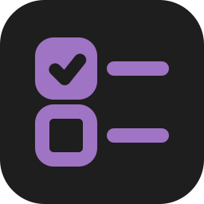

#  LLMD

**Steer the architecture, let the agent write the code.**

LLMD is a small spec format for working with coding agents like Claude Code and Codex. In a `.llmd` file you describe the files, types, methods and logic you want, top-down, the way the code flows. You split the work into **steps**, like issues, and the agent builds one step at a time: it asks first, stays inside the step, and ticks it when it's done. The spec is your intent and the code is the proof: once the code has what a step lists, you mark it **Done** and it leaves the spec.

```
# Calculator
lang: csharp

## Let the user quit
+HandleUser.cs
  - ReadUserInput()
    - read the input like before
    - quit on q
  ? should q also work in the middle of entering numbers
  ! entering q exits with code 0

@Program.cs
  - use HandleUser.ReadUserInput
```

`@` is an existing file, `+` a new one, `-` a method or a line of logic, `?` a question the agent must ask you, and `!` a check that must pass before the step is done. The rest is plain markdown.

LLMD has two parts:

- **A VS Code extension** that makes `.llmd` a real language that knows your code: highlighting, `@` file completion, an outline, warnings for broken references, and, under a file, its real methods to complete, their hovers and Ctrl+click into the code. What a step adds is green. **▶ Implement** / **Plan** above each step turns the editor into the step's run: the step stays live on one side while the agent builds it, and you talk to it on the other.
- **An agent skill** that teaches Claude Code, Codex and other agents what the syntax means and how to implement a step.

**→ Read the [guide](https://github.com/Viedin/llmd/blob/main/docs/guide.md)** for the full syntax and workflow.

## Install

You only do this once. After that it works in every project.

### The extension

Download it from the latest release and install it. Run the same two commands to update:

```bash
curl -LO https://github.com/viedin/llmd/releases/latest/download/llmd.vsix
code --install-extension llmd.vsix
```

Cursor, Windsurf and VSCodium install the same file: use `cursor`, `windsurf` or `codium` in place of `code`. Any file ending in `.llmd` now uses the extension. The status bar's language mode shows **LLMD**.

### The skill

In Claude Code:

```
/plugin marketplace add viedin/llmd
/plugin install llmd@llmd
```

For Codex and other agents:

```bash
npx skills add viedin/llmd
```

The skill comes straight from the repo, so there's nothing to build. New sessions list `llmd` among their skills (in Codex, `/skills` shows it).

## Quick start

1. Open your project **folder** in VS Code.
2. Run **LLMD: New feature** and write its `## step`, or create `.llmd/app.llmd` with a title, a `lang:` line and a first `## step`.
3. Click **▶ Implement** above the step, or tell your agent `implement the next step`.
4. Answer its questions, review the diff, and once it has ticked the step and the code has what it lists, mark it **✓ Done**.

The [guide](https://github.com/Viedin/llmd/blob/main/docs/guide.md) covers each of these in depth: [starting a project](https://github.com/Viedin/llmd/blob/main/docs/guide.md#1-start-a-project), [every line type](https://github.com/Viedin/llmd/blob/main/docs/guide.md#line-types), [handing decisions to the agent](https://github.com/Viedin/llmd/blob/main/docs/guide.md#hand-decisions-to-the-agent), [reviewing a step](https://github.com/Viedin/llmd/blob/main/docs/guide.md#review) and [runs](https://github.com/Viedin/llmd/blob/main/docs/guide.md#runs).

## Contributing

Issues and pull requests are welcome. LLMD is planned in its own format: [.llmd/spec.llmd](.llmd/spec.llmd) holds the steps in progress.

Build the extension and install it into your normal VS Code, then reload the window. `npm install` only fetches the dependencies; packaging compiles:

```bash
npm install
npx @vscode/vsce package --out llmd.vsix
code --install-extension llmd.vsix --force
```

Link the skill to your checkout, so edits apply straight away:

```bash
ln -sfn "$PWD/skills/llmd" ~/.claude/skills/llmd
ln -sfn "$PWD/skills/llmd" ~/.codex/skills/llmd
```

- `npm test` checks the parsers (paths, outline, symbols).
- `npm run test:e2e` starts a separate copy of VS Code and checks completion, warnings, colors, Enter, dimming, the outline, Ctrl+click, what the plan knows about the code, and a step's run. The first run downloads that copy into `.vscode-test/`.
- **F5** opens a debug window running your current code. Open `.llmd` files there with **File → Open File**.

### Releasing

1. Bump `version` in both `package.json` and `.claude-plugin/plugin.json`. Claude Code only updates the skill when the plugin's version changes.
2. Commit, then push the commit and a matching tag:
   ```bash
   git tag "v$(node -p "require('./package.json').version")"
   git push origin main --tags
   ```
3. The Release workflow checks the tag matches `package.json`, then builds `llmd.vsix` with `vsce package` and attaches it to a GitHub release. `.vscodeignore` decides what goes in it.
4. Upload the same `llmd.vsix` to the VS Code Marketplace by hand: download it from the release, then on the [publisher page](https://marketplace.visualstudio.com/manage/publishers/viedin) use **Update** (the first time, **New extension → Visual Studio Code**).

The skill needs no build: Claude Code and `npx skills` read `skills/llmd/` from `main`.

## License

[MIT](LICENSE)
